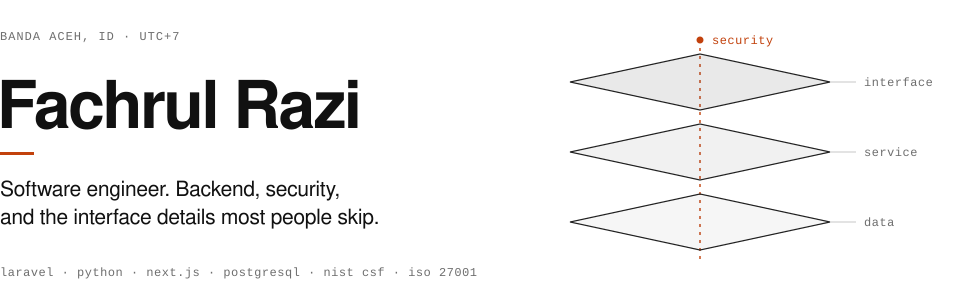

<picture>
  <source media="(prefers-color-scheme: dark)" srcset="assets/header-dark.svg">
  
</picture>

 

I'm Fachrul, a software engineer from Aceh, Indonesia. For the past decade I've built the internal systems a large energy company and the organizations around it run on: budgeting, safety permits, vendor payments, membership. These days my time goes into backend work, application security, and the interfaces that sit on top of both.

I like the unglamorous parts done properly. Access rules that are actually enforced. Migrations that can roll back. Forms that people fill in once, correctly, without asking someone for help.

 

#### Selected work

**Membership platform** 
One source of truth for 32,000+ active members, plus single sign-on and role-based access for the apps built around it. Every change leaves an audit trail. 
Laravel · MySQL · Sanctum · REST

**Integrated accounting system** 
Journal-based accounting for an organization that runs at three levels: national, regional and branch. Dues come in, get split by rule and post as journals at every level, so each office closes its own books from the same data. Logins and roles come from the membership platform through SSO. I own the architecture and lead a team of four, pairing experienced developers with newer ones who build AI-assisted. 
Laravel · Livewire · MySQL · Tailwind

**Cafe operations platform** 
Everything a growing cafe group runs on, built around one POS. Members get a mobile-first web app with OTP login, points, stamps, rewards and a menu that reads straight from the POS. Staff get a portal for attendance, cash advances and payslips, plus cash-register opening and closing with expenses and denominations. An API turns each day's sales and expenses into accounting journals and monthly reports, so the numbers on the counter and in the books are the same numbers. 
Laravel · Inertia · Blade · MySQL · REST API · PWA

**Arunika** 
A trading-signal platform for MetaTrader 5. Strategy, risk and ML all live on the server; the terminal only executes. Walk-forward testing, meta-labeling, admin login behind TOTP. 
Python · FastAPI · PostgreSQL · LightGBM · Next.js

**Nawala** 
A small crew of AI agents for a cafe: it reads the POS data, writes the morning report and answers customers on WhatsApp. Anything that reaches a customer waits for the owner's approval first. 
Laravel · Node.js · Claude API · GitHub Actions

**SIPAT** 
Budget management from planning to reporting, rolled out across 21 regional units. First place at the company's national innovation awards, 2017. 
PHP · MySQL

 

#### Now

Finishing a Master of IT at Universiti Tenaga Nasional, Malaysia. My thesis looks at cybersecurity governance where IT meets OT in renewable energy plants, using NIST CSF 2.0 and ISO/IEC 27001.

Open to remote or full-time roles in backend, full-stack or application security.

 

#### A note on this profile

Most of what I've built is private, because it belongs to clients and organizations. I'm happy to walk through any of it on a call, screen shared.

 

[LinkedIn](https://www.linkedin.com/in/fachrul-razi-5669b850/) &nbsp;·&nbsp; Banda Aceh, UTC+7
